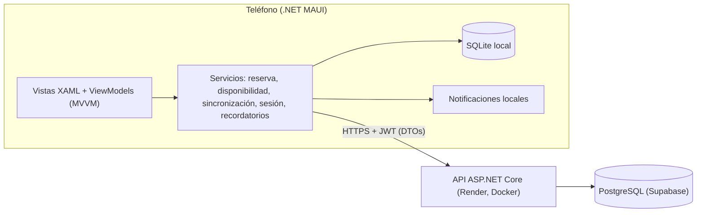
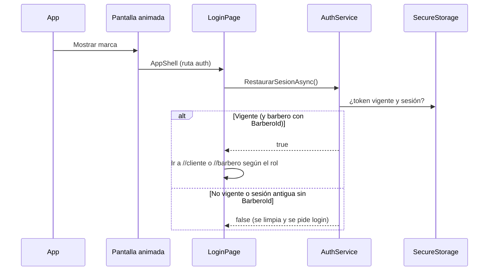
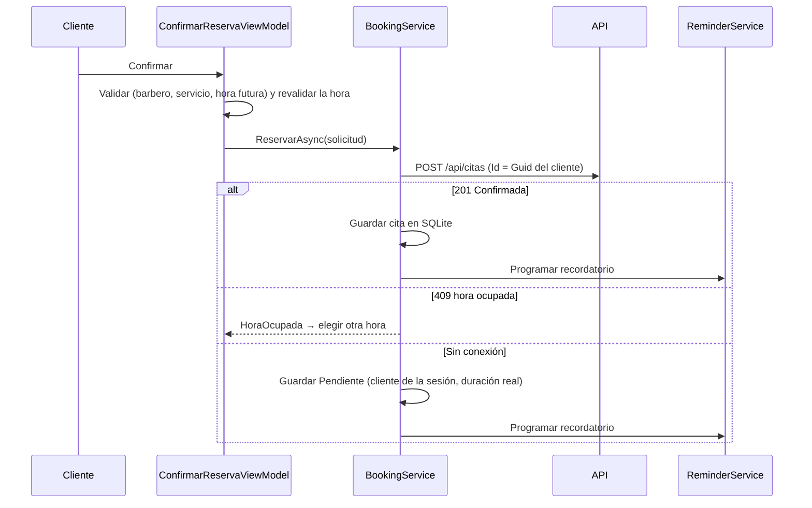
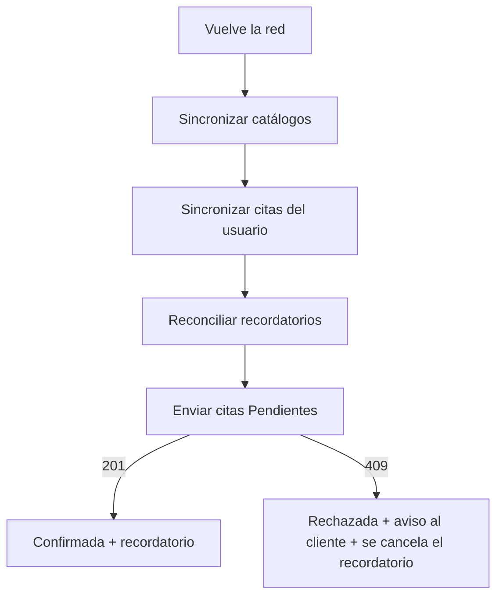
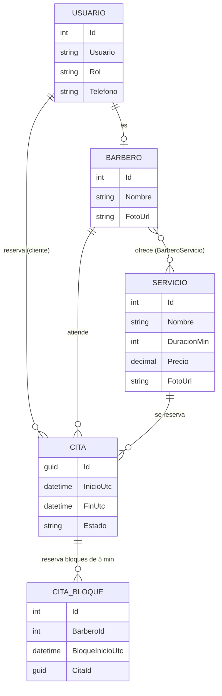

# Arquitectura de BarberTurno

Visión técnica de cómo está construida la aplicación: capas, componentes, flujos de datos, modelo de datos, API,
seguridad y despliegue. Las **razones** de cada elección están en [Decisiones](02-decisiones.md) y las pantallas en
[Pantallas y flujos](03-pantallas.md).

## 1. Visión general

BarberTurno es una aplicación **.NET MAUI** (Android, con soporte para Windows) con una **API REST ASP.NET Core** y
base de datos **PostgreSQL (Supabase)**. La app guarda una copia local en **SQLite** para funcionar sin conexión.



| Componente | Tecnología | Responsabilidad |
|---|---|---|
| App móvil | .NET 10 MAUI, C#, XAML, CommunityToolkit.Mvvm 8.4 | Interfaz, lógica de presentación, caché local, uso sin conexión |
| Almacenamiento local | SQLite (`sqlite-net-pcl`), modo WAL | Clientes, barberos, servicios, relación barbero-servicio y citas |
| Sesión | `SecureStorage` (Keystore de Android) | Token JWT, expiración y datos de la sesión |
| Recordatorios | `Plugin.LocalNotification` 14.1 | Aviso local antes de la cita |
| API | ASP.NET Core 9, EF Core 9, JWT Bearer, BCrypt, Swagger | Autoridad sobre disponibilidad, reservas y usuarios |
| Base de datos | PostgreSQL (Supabase, *pooler*) | Datos compartidos y restricciones únicas |
| Hosting | Render (contenedor Docker) | Publica la API con HTTPS |

## 2. Capas de la aplicación móvil

Regla de dependencia: **cada capa solo conoce a la de abajo**. Una vista nunca llama a un repositorio, ni un
ViewModel conoce a una vista.

| Capa | Carpeta | Contiene | Ejemplos |
|---|---|---|---|
| Vistas | `Views/`, `Controls/` | XAML con enlaces de datos; code-behind mínimo | `LoginPage`, `AgendaDiaPage`, `StateView`, `EstadoBanner` |
| ViewModels | `ViewModels/` | Estado y comandos de cada pantalla (hereda `BaseViewModel`) | `SeleccionHoraViewModel`, `AgendaDiaViewModel` |
| Servicios | `Services/` | Lógica de negocio y coordinación | `BookingService`, `AvailabilityService`, `SyncService`, `AuthService`, `ReminderService`, `NavigationService` |
| Datos | `Data/` | Repositorios y acceso a SQLite | `CitaRepository`, `AppDatabase` |
| Red | `Services/Api`, `Dtos/`, `Mappers/` | Cliente HTTP, objetos de transferencia y traductores | `BarberTurnoApi`, `DtoMapper` |
| Modelos | `Models/` | Entidades locales | `Cita`, `Barbero`, `Servicio`, `Cliente` |
| Ayudantes | `Helpers/` | Utilidades sin estado | `AgendaLoader`, `AvisosHelper`, `FotoHelper`, `Motion`, convertidores |

### Estructura del repositorio

```text
BarberTurno/
├── src/
│   ├── BarberTurno/            # App .NET MAUI
│   │   ├── Controls/  Converters/  Data/  Dtos/  Helpers/  Mappers/  Models/
│   │   ├── Platforms/  Resources/  Services/  ViewModels/  Views/
│   └── BarberTurno.Api/        # API ASP.NET Core
│       ├── Controllers/  Data/  Domain/  Dtos/  Services/  Dockerfile
├── docs/                       # Esta documentación, ADR, scripts SQL y bocetos
│   ├── 01-arquitectura.md  02-decisiones.md  03-pantallas.md
│   ├── adr/  db/  diseno/  api-contract.md
└── tests/                      # xUnit + Moq
```

### Inyección de dependencias y ciclos de vida

Todo se registra en `MauiProgram`, un método por capa (`AddDataLayer`, `AddApiLayer`, `AddAuthLayer`, `AddSyncLayer`,
`AddNotificationLayer`, `AddBookingLayer`, `AddPresentationLayer`).

| Ciclo de vida | Qué se registra | Por qué |
|---|---|---|
| Singleton | Base de datos y repositorios, `HttpClient`/API, sesión, red, sincronización, navegación, diálogos, recordatorios | Una sola conexión, una sola sesión, estado compartido |
| Transient | ViewModels, páginas, `IBookingService`, `IAvailabilityService` | Cada pantalla nace limpia |

## 3. Flujos principales

### 3.1 Arranque y sesión



La sesión **no se borra al cerrar la app**: el login la restaura mientras el token siga vigente. Cerrar sesión limpia
`SecureStorage` y la sesión en memoria.

### 3.2 Reserva de un turno



### 3.3 Sincronización y uso sin conexión

`SyncService` se dispara cuando **vuelve la red** y al abrir las pantallas que lo necesitan. Descarga catálogos y citas
y envía las reservas pendientes. Los pasos y las reglas de conflicto están en el
[ADR-0004](02-decisiones.md#adr-0004-estrategia-de-datos-y-sincronización-fuente-de-verdad-y-modo-sin-conexión).



### 3.4 Regla central: sin citas solapadas

Defensa en profundidad, con el **servidor como autoridad**: horas libres mostradas, comprobación de solape en una
transacción, **índice único por bloques de 5 minutos** (`CitaBloques`), idempotencia por `Id`, e índice único parcial
en SQLite. Detalle completo en el
[ADR-0008](02-decisiones.md#adr-0008-cómo-se-evita-que-dos-citas-queden-a-la-misma-hora).

### 3.5 Recordatorio de la cita

`ReminderService` programa una notificación local **60 minutos antes** (o a los pocos segundos si falta menos),
pide el permiso de notificaciones al reservar, y la cancela al cancelar o rechazarse la cita. Tras cada sincronización
se **reconcilia** con las citas vigentes. Ver [ADR-0009](02-decisiones.md#adr-0009-recordatorios-con-notificaciones-locales).

## 4. Modelo de datos



- **Estados de una cita:** `Pendiente`, `Confirmada`, `Rechazada`, `Cancelada`, `Atendida`, `Ausente`.
- **Fechas:** el servidor y los DTO usan **UTC**; en SQLite `Cita.Inicio` y `Fin` se guardan en **hora local**
  (`DtoMapper` convierte en ambos sentidos). Al leer de SQLite el `Kind` se pierde, por lo que **no se debe llamar
  `ToLocalTime()` sobre `Cita.Inicio`**.
- **Esquema en Supabase:** lo crea `EnsureCreated()` solo si la base está vacía. Todo cambio posterior de esquema
  requiere un script numerado en `docs/db/` (`001_esquema_inicial`, `002_servicios_fotourl`,
  `003_citabloques_relleno`), ejecutado **antes** de desplegar.

## 5. API REST

Base: `https://<servicio>.onrender.com/api/` · Documentación interactiva (Swagger) en la raíz del servicio.

| Método y ruta | Acceso | Descripción |
|---|---|---|
| `POST /auth/login` · `POST /auth/register` | Público | Inicio de sesión y registro; devuelve JWT, `UsuarioId` y `BarberoId` (barberos) |
| `GET /barberos` | Público | Barberos con sus `ServicioIds` |
| `PUT /barberos/{id}/foto` · `PUT /barberos/{id}/servicios` | Sin protección actual (*) | Foto de perfil y servicios que ofrece |
| `GET /servicios` · `POST /servicios` | Público / sin protección actual (*) | Catálogo y alta de servicios (con foto opcional) |
| `GET /disponibilidad?barberoId&servicioId&fecha` | Público | Franjas libres según la duración y las citas existentes |
| `GET /citas` | JWT | Citas del usuario (cliente: las suyas; barbero: su agenda) |
| `POST /citas` | JWT | Crea la cita (`Id` = clave de idempotencia); `409` si la hora está ocupada |
| `POST /citas/{id}/cancelar` | JWT | Cancela y libera los bloques de la hora |
| `GET /clientes` | Barbero | Clientes que han agendado |

(*) **Limitación conocida:** estos endpoints de escritura no exigen todavía un token con rol Barbero; es una mejora de
seguridad pendiente (añadir `[Authorize(Roles = "Barbero")]`).

Contrato detallado: [`api-contract.md`](api-contract.md). Si la API cambia un campo, solo se modifican los **DTOs**
(`Dtos/Dtos.cs`) y los **mapeadores**; el resto de la app queda intacto ([ADR-0005](02-decisiones.md#adr-0005-capa-de-red-y-traducción-de-datos)).

## 6. Seguridad y configuración

| Tema | Cómo se resuelve |
|---|---|
| Credencial del usuario | Token JWT en `SecureStorage` (Keystore); la contraseña nunca se guarda y se borra de memoria tras cada intento |
| Contraseñas en el servidor | Hash BCrypt |
| Roles | JWT con rol; los endpoints de barbero exigen `Roles = "Barbero"` |
| Secretos | Fuera del repositorio: `dotnet user-secrets` (desarrollo) y variables de entorno (servidor). La API **no arranca** sin `Jwt:Key` (≥ 32 caracteres) ni cadena de conexión |
| Base de datos | Políticas RLS activadas en todas las tablas de Supabase |
| Tráfico | HTTPS en producción (Render). `usesCleartextTraffic` sigue activo para el emulador; pendiente desactivarlo en la versión final |

## 7. Configuración, compilación y despliegue

- **Requisitos:** .NET 9 y .NET 10 SDK, carga de trabajo MAUI (`dotnet workload install maui`), emulador o teléfono Android.
- **Secretos de la API en desarrollo** (una vez por PC, en `src/BarberTurno.Api`):
  ```bash
  dotnet user-secrets set "ConnectionStrings:DefaultConnection" "Host=...;Port=5432;Database=postgres;Username=postgres.<ref>;Password=<contraseña>;SSL Mode=Require"
  dotnet user-secrets set "Jwt:Key" "<cadena aleatoria de 32 o más caracteres>"
  ```
- **Ejecutar la API:** `dotnet run --project src/BarberTurno.Api --urls "http://127.0.0.1:5000"` (Swagger en la raíz).
- **Ejecutar la app:** abrir la solución en Visual Studio y ejecutar `BarberTurno` en Android. El emulador usa la API local
  (`10.0.2.2:5000`); un teléfono real usa la URL de producción definida en `AppConstants`.
- **Despliegue de la API:** Render con Docker (*Root Directory* `src/BarberTurno.Api`) y las variables
  `ConnectionStrings__DefaultConnection` y `Jwt__Key`. Antes de desplegar un cambio de esquema, ejecutar el script
  correspondiente de `docs/db/` en Supabase.
- **Pruebas:** `dotnet test tests/BarberTurno.Tests/BarberTurno.Tests.csproj` (xUnit + Moq): solape local, mapeadores,
  ViewModels con repositorios simulados, agenda del barbero, detalle con historial, recordatorio y reserva sin conexión.

### Usuarios de prueba

| Rol | Usuario | Contraseña |
|---|---|---|
| Cliente | `cliente1` | `123456` |
| Barbero | `barbero1` · `barbero2` | `123456` |
