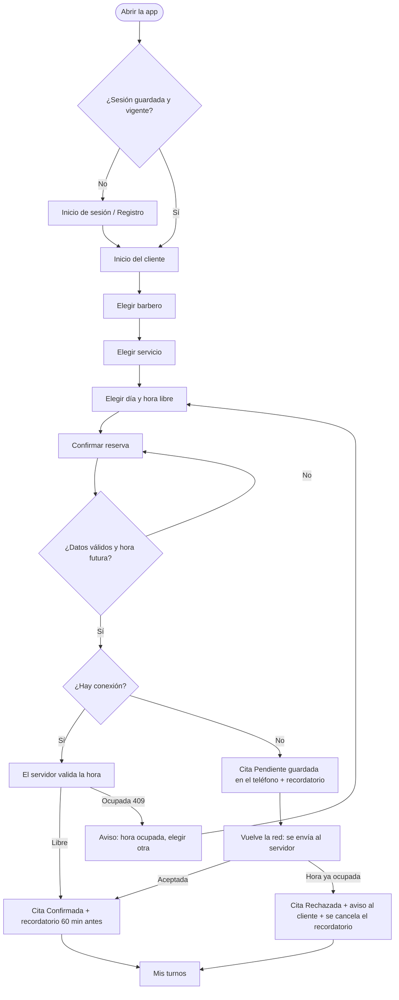
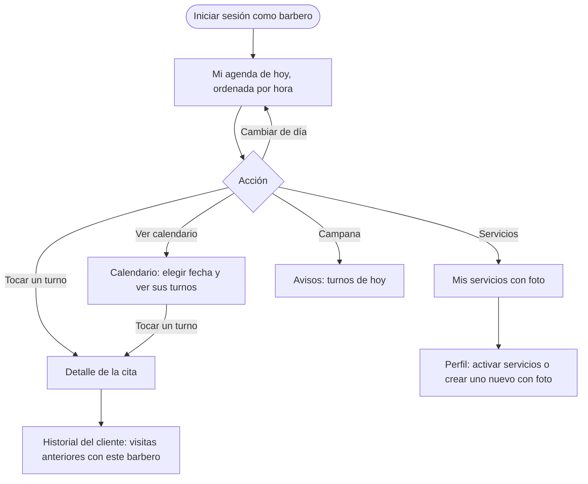
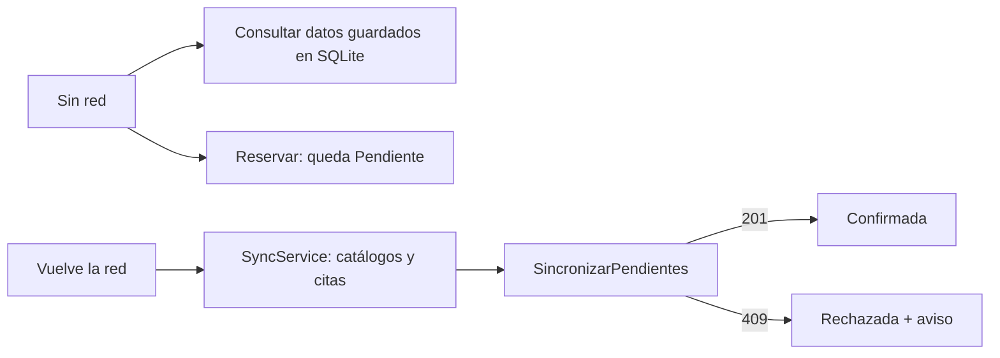

# Pantallas y flujos de usuario

Catálogo de las pantallas de BarberTurno, sus flujos y los bocetos de diseño. La paleta es carbón `#1B1B17`, crema
`#F8F7F3` y dorado `#D6B362`, con **tema claro y oscuro** ([ADR-0011](02-decisiones.md#adr-0011-tema-visual-claro-y-oscuro)).
Cómo está construida cada capa: [Arquitectura](01-arquitectura.md).

## 1. Navegación

La app usa **Shell** con tres grupos de pestañas: `auth` (sin barra), `cliente` y `barbero`
([ADR-0002](02-decisiones.md#adr-0002-estrategia-de-navegación-entre-los-perfiles-de-cliente-y-barbero)).

| Perfil | Pestañas inferiores |
|---|---|
| Cliente | Inicio · Mis turnos · Reservar · Servicios · Perfil |
| Barbero | Mi agenda · Calendario · Servicios · Clientes · Perfil |

Pantallas apiladas (se abren encima de una pestaña): Registro, Servicios del barbero, Selección de hora, Confirmar
reserva y Detalle de cita.

## 2. Inventario de pantallas

Estados: **SV** = `StateView` (reemplaza el contenido según Cargando / Vacío / Error / Con datos) ·
**EB** = `EstadoBanner` (indicador de carga y error con reintento; el vacío lo resuelve la propia pantalla).

### Compartidas

| Pantalla | Para qué sirve | Datos y acciones | Estados |
|---|---|---|---|
| Presentación | Marca animada al abrir; continúa el splash nativo | — | — |
| Inicio de sesión | Entrar como cliente o barbero | Usuario y contraseña; restaura sesión guardada; enlace a Registro | Error de credenciales en pantalla |
| Registro | Crear cuenta (cliente o barbero) | Nombre, usuario, teléfono, contraseña, rol | Validación de campos |
| Perfil | Datos de la cuenta, foto, tema y cierre de sesión | Foto con **cámara** o **galería**; interruptor de tema oscuro; cerrar sesión. Barbero: activar servicios y **crear uno nuevo con foto** | SV |

### Cliente

| Pantalla | Para qué sirve | Datos y acciones | Estados |
|---|---|---|---|
| Inicio | Resumen del día | Próximo turno, atajo «Reservar un turno», equipo de barberos | EB |
| Elegir barbero (Reservar) | Lista de barberos con foto y servicios | Tocar para ver sus servicios; aviso «sin conexión» | SV |
| Elegir servicio | Servicios del barbero con foto del resultado, duración y precio | Tocar para elegir la hora | SV |
| Catálogo (Servicios) | Todos los servicios | Destacado y botón Reservar | SV |
| Elegir hora | Día y horas libres según la duración del servicio | Cambiar de día, escoger franja | SV |
| Confirmar reserva | Resumen y confirmación | Valida antes de enviar; muestra «sin conexión» y hora ocupada | SV |
| Mis turnos | Próximas y anteriores | Cancelar; estado Confirmada / Pendiente / Rechazada; arrastrar para actualizar | SV |

### Barbero

| Pantalla | Para qué sirve | Datos y acciones | Estados |
|---|---|---|---|
| Mi agenda | Citas del día ordenadas por hora | Día anterior / siguiente / Hoy, turnos del día, ingresos, campana de avisos; tocar una cita abre su detalle | EB |
| Calendario | Turnos de cualquier fecha | Selector de fecha, resumen del día; tocar un turno abre su detalle | EB |
| Detalle de cita | Datos de la cita y **historial del cliente** | Cliente, teléfono, servicio, estado y visitas anteriores con este barbero (sin canceladas) | EB |
| Mis servicios | Catálogo del barbero, tal como lo ve el cliente | Servicios activos con foto; enlace a Perfil para editar | EB |
| Clientes | Lista de clientes que han agendado | Nombre y teléfono | EB |

## 3. Flujos de usuario

### Cliente: reservar un turno

### Barbero: agenda e historial del cliente

### Sin conexión

## 4. Bocetos

Archivos fuente en [`diseno/`](diseno/): `bocetos-cliente.svg|png` y `bocetos-barbero.svg|png`.

### Perfil cliente

### Perfil barbero

## 5. Comportamientos transversales de la interfaz

- **Estados:** toda pantalla que carga datos maneja Cargando, Vacío, Error y Con datos
  ([ADR-0010](02-decisiones.md#adr-0010-manejo-de-estados-de-interfaz-y-errores)).
- **Animaciones:** las pantallas principales entran en cascada (`Motion.Enter`) y el botón dorado reacciona al pulsarlo.
- **Permisos del dispositivo:** notificaciones al reservar (recordatorio), cámara al tomar la foto de perfil; la galería usa
  el selector del sistema, que no requiere permiso en Android 13 o superior.
- **Sin conexión:** las fotos remotas no se descargan sin internet; se muestra la inicial en su lugar.
