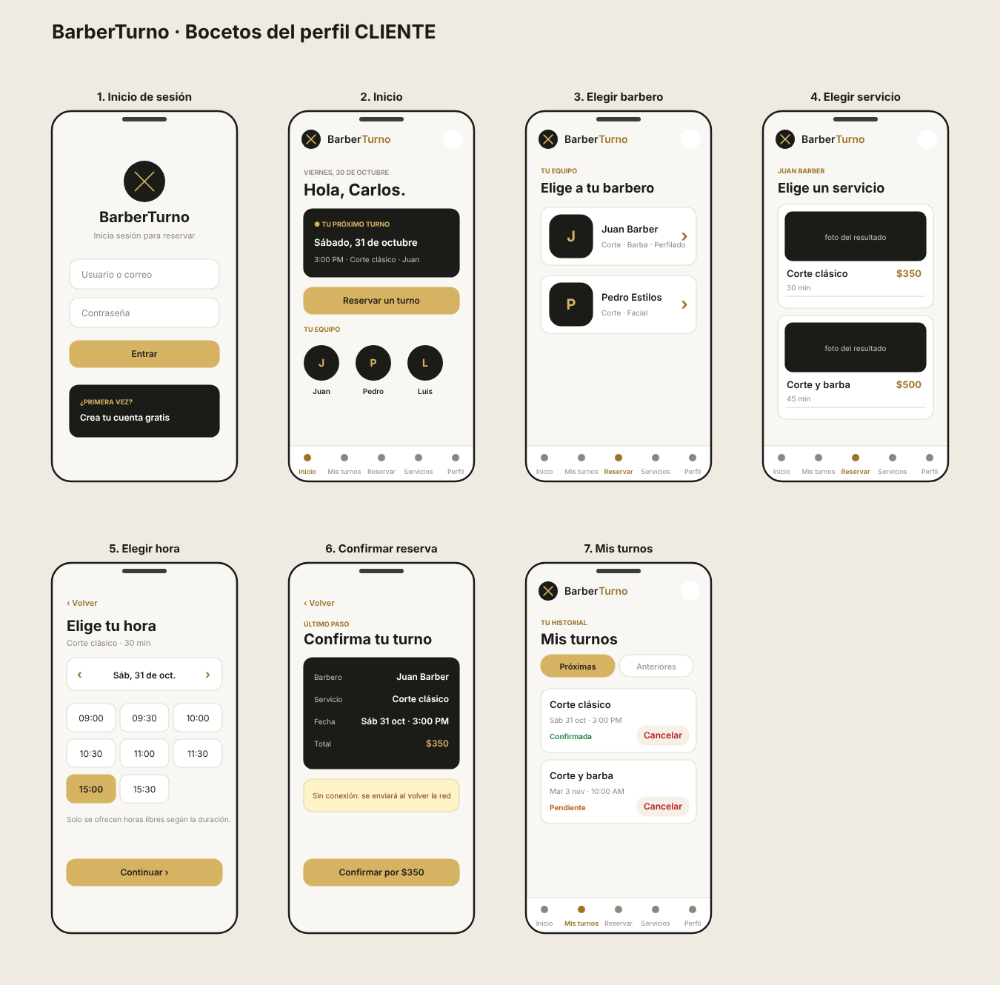
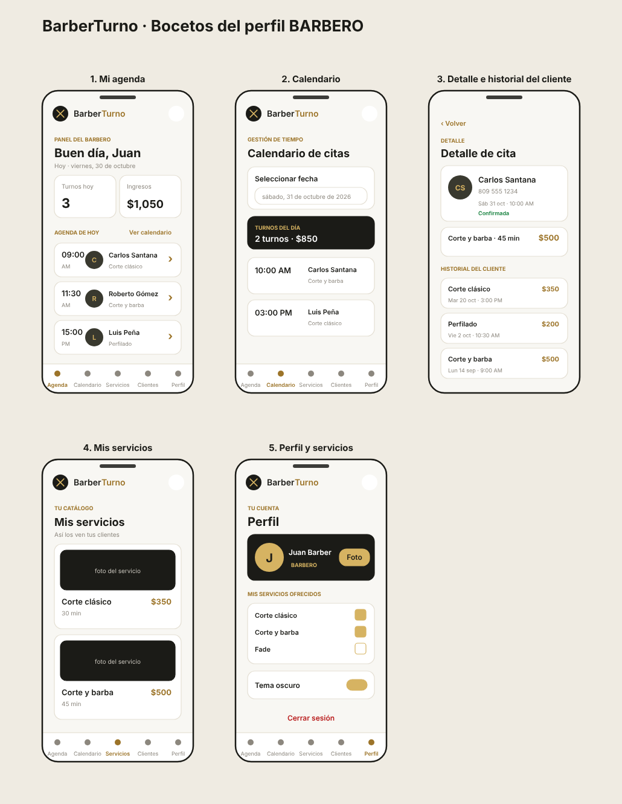
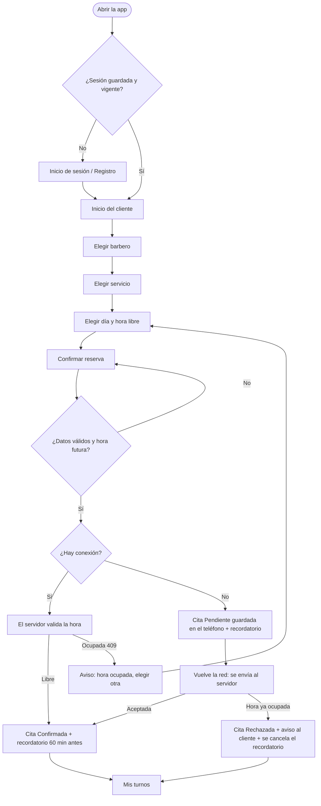
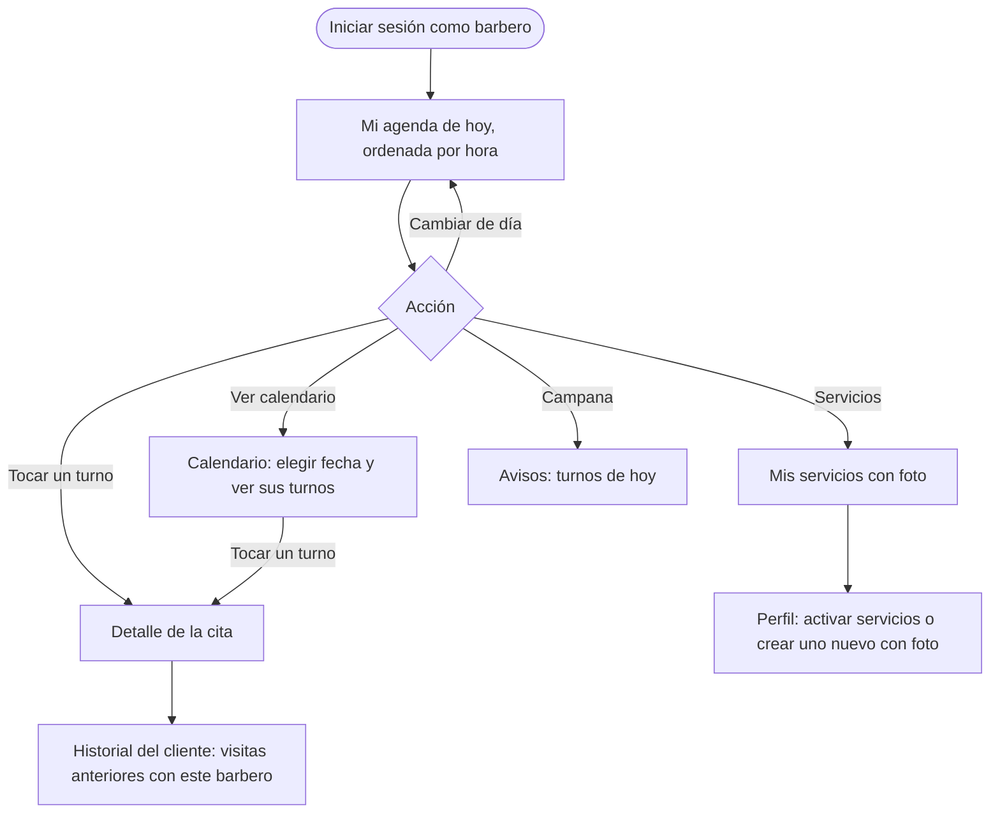
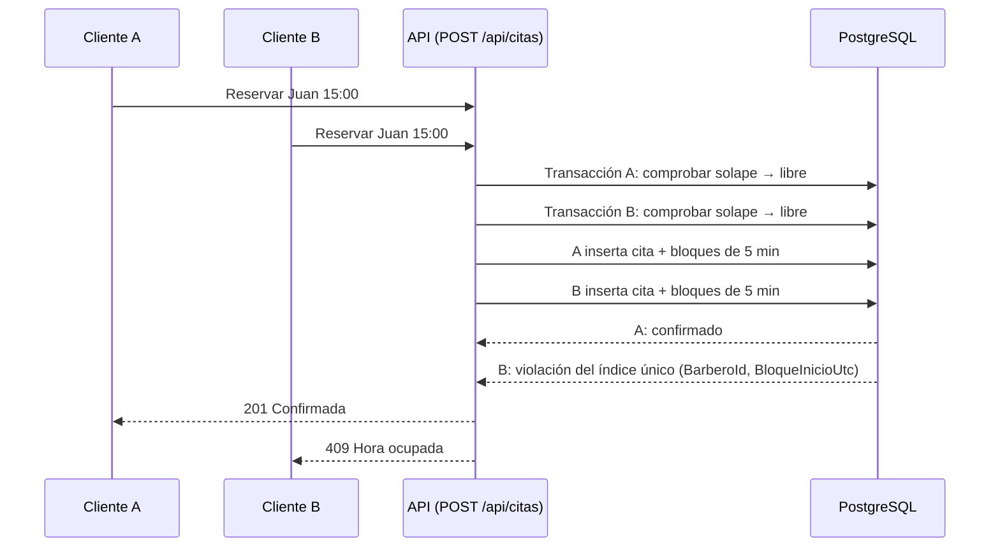
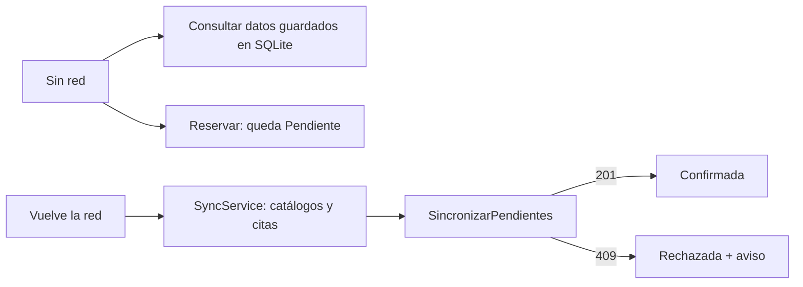

# Material de diseño

Flujos de usuario y bocetos de las pantallas principales de BarberTurno (cliente y barbero).
La paleta es carbón `#1B1B17`, crema `#F8F7F3` y dorado `#D6B362`, con tema claro y oscuro (ver ADR-0011).

## Bocetos de pantallas

| Perfil | Archivo | Pantallas |
|---|---|---|
| Cliente | [`bocetos-cliente.svg`](bocetos-cliente.svg) · [`.png`](bocetos-cliente.png) | Inicio de sesión, Inicio, Elegir barbero, Elegir servicio (con foto del resultado), Elegir hora, Confirmar reserva, Mis turnos |
| Barbero | [`bocetos-barbero.svg`](bocetos-barbero.svg) · [`.png`](bocetos-barbero.png) | Mi agenda, Calendario, Detalle de cita con historial del cliente, Mis servicios, Perfil |

## Flujo del cliente: reservar un turno

## Flujo del barbero: agenda e historial del cliente

## Secuencia: dos clientes reservan la misma hora casi a la vez

Detalle de la decisión en [ADR-0008](../adr/0008-como-se-evita-que-dos-citas-queden-a-la-misma.md).

## Flujo sin conexión

Detalle en [ADR-0004](../adr/0004-datos-y-sincronizacion-fuente-de-verdad-y-mod.md).
